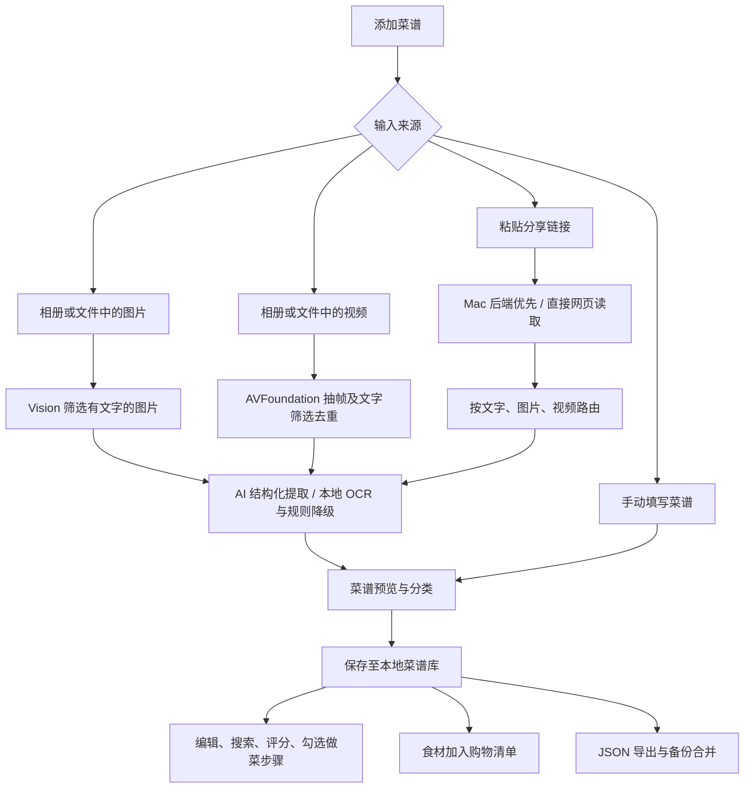
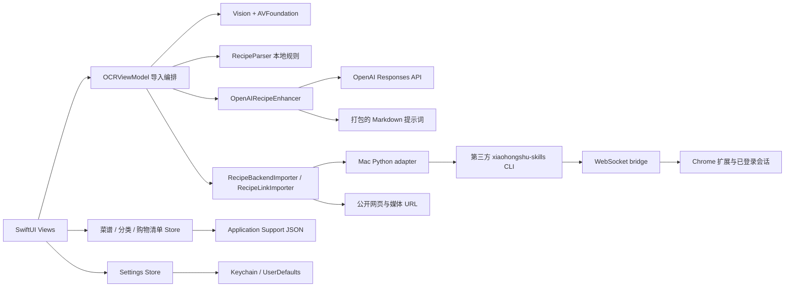

# RednoteOCR：功能、工作流、逻辑树与技术简历

检查日期：2026-09-28。依据当前工作区源代码，包括检查前已有的未提交改动；不将旧 README 或未调用的代码当成已实现功能。

## 1. 这个 app 到底做什么

这是一个面向个人的 **iOS 多模态菜谱整理工具**：把社交平台里的截图、带文字的视频、分享链接转换成可以编辑、收藏、照着做和用于采购的结构化菜谱。

它解决的是“收藏了帖子，但做饭时还要重新找食材、翻步骤”的问题。主要产物是菜谱数据，而不是 OCR 文本。OCR 是本地筛选与降级能力；AI 负责从图文中整理结构；SwiftUI 提供完整的菜谱库和购物清单操作。

定位适合写成个人项目或工程原型。代码中没有用户规模、上线收入、准确率、成本下降或性能提升的实测证据。

## 2. 用户工作流



具体操作：打开 `Add Recipe` → 选择图片、视频、链接或手写 → 检查解析结果并选分类 → `Save` → 在菜谱详情中编辑或逐步勾选完成 → 把食材加入购物清单。Settings 管理 API key、后端 URL 和备份。

## 3. 导入逻辑树：实际执行分支

```text
添加菜谱
├─ 手动输入
│  └─ ManualRecipeComposerView → RecipeDraft → 保存
├─ 图片（Photos / Files）
│  ├─ 读取图片 → Vision 判断是否有足够文字及文字面积
│  ├─ 无合格图片 → 显示无可用内容
│  ├─ 有 API key → imageFirst AI 提取 → 标题校验 → 预览
│  └─ 无 key / AI 请求失败 → Vision OCR → RecipeParser → 本地预览
├─ 视频（Photos / Files）
│  ├─ AVFoundation 每 0.3 秒采样，Vision 分析文字
│  ├─ 连续相同文字签名保留得分较高帧 → 最多均匀保留 50 帧
│  ├─ 无可用文字帧 → 导入失败提示
│  └─ 有效帧 → imageFirst AI；无 key / AI 失败 → OCR + 规则解析
└─ 分享链接
   ├─ 配置了 Mac URL → POST /imports/link
   │  └─ 后端请求失败 → 直接 GET 分享页面
   ├─ 未配置 Mac URL → 直接 GET 分享页面
   ├─ 提取标题、正文、图片、视频地址 → 构造本地候选菜谱
   └─ 按媒体类型分支
      ├─ 视频帖
      │  ├─ 无视频 URL → 尝试仅按帖子文字解析
      │  └─ 有视频 URL → 下载/抽帧 → AI；失败后 OCR 解析有效帧
      └─ 非视频帖
         ├─ 0 张有效文字图片 → textFirst
         ├─ 1–7 张有效文字图片 → mixed
         ├─ 8 张及以上 → imageFirst
         └─ 无 key / AI 失败 → 本地正文解析
            └─ 有图片，且候选菜谱全空，或无步骤/食材≤2/无分组 → 补做图片 OCR
```

本地降级结果会保留导入上下文，允许添加 key 后通过 `Retry AI` 重新解析。取消通常有单独的状态提示，不等于所有异步工作都已实现彻底取消。

视频当前优先走抽帧路径，**没有启用“先判断正文够不够、再决定是否抽帧”**。图片也不是不加筛选地全部发给模型：纯成品照片可能被文字筛选器过滤。视频没有音频转写；纯口述、无字幕视频不在当前可靠处理范围。

## 4. 系统架构与模块职责



| 模块 | 实际责任 |
| --- | --- |
| `RednoteOCRApp.swift` | 建立五个共享 Store，通过环境对象注入界面 |
| `ContentView.swift` | 菜谱库、搜索排序、分类筛选、购物页、菜谱详情与步骤进度 |
| `AddRecipeView.swift` / `RecipeEditorView.swift` | 导入界面、手动录入、保存和编辑 |
| `OCRViewModel.swift` | 导入状态、媒体路由、AI/本地回退、重试上下文 |
| `VideoFrameExtractor.swift` | 视频采样、文字检测、相邻重复帧选择、帧数限制 |
| `RecipeParser.swift` | 基于词表和正则提取标题、食材、步骤、时间、提示和分组 |
| `OpenAIRecipeEnhancer.swift` | 请求构造、严格 JSON schema、响应归一化、标题二次校验 |
| `RecipeParserSkillPrompts.swift` | 从 app bundle 中的 Markdown 指定章节组合提示词 |
| `RecipeBackendImporter.swift` | 适配后端 JSON、内嵌图片、远程图片、视频资产地址 |
| `RecipeLinkImporter.swift` | 直接请求分享网页，解析 HTML 与元数据 |
| `RecipeLibraryStore.swift` / `CategoryStore.swift` / `ShoppingCartStore.swift` | 本地状态与 JSON 持久化 |
| `OpenAISettingsStore.swift` / `LocalBackendSettingsStore.swift` | Keychain 中的 API key 与 UserDefaults 中的后端地址 |
| `OpenAISettingsView.swift` | 设置、连通性检查、备份导入导出与冲突处理 |
| `LocalBackend/adapter_server.py` | HTTP 适配、分享链接解析、调用第三方 CLI、媒体下载与缓存 |

整体是 SwiftUI 的 View + ObservableObject/Store 分层，可称为 MVVM 风格。后端是 Python 标准库 `ThreadingHTTPServer`，不是 FastAPI；持久化是 Codable/JSON，不是 SQL、Core Data 或 SwiftData。

## 5. AI 处理与数据模型

代码配置的模型标识是 `gpt-5.4-nano`，接口是 `/v1/responses`。这只是当前源码配置，本次没有进行真实 API 调用，也没有验证账号模型权限。

主提取请求采用严格 JSON schema；返回值归一化为以下本地模型（`rawLine` 由本地生成）：

```text
RecipeDraft
├─ title
├─ ingredients[]: name / amount / unit / rawLine
├─ steps[]
├─ tips[]
├─ timeHints[]
└─ sections[]: title / ingredients[] / steps[]

SavedRecipe（保存后）
├─ 上述菜谱内容与稳定 ID
├─ category / rating / createdAt
├─ completedStepKeys[]: sectionID + stepIndex
└─ sourceURLString / rawText
```

模型原始输出还会经过本地处理：去空项、合并替代食材、去重、避免分组和顶层重复、过滤社交引导文案、在缺失字段时使用本地候选内容。主提取后通常再发一个小请求校验菜名；标题请求普通失败时保留主提取结果，提示词资源缺失则作为配置错误传出。

图片发出前最长边缩至最多 1400，优先按 JPEG 质量 0.82 编码。视频帧上限 50 和文本截断限制属于实现参数，不是已验证的延迟、成本或准确率指标。使用 AI 时，选中的图片/帧和相应文本会离开设备发送至 API；本地 OCR 路径不需要该 AI 请求。

## 6. Mac 后端工作流

```text
iPhone: POST /imports/link {input: 分享文本}
→ 提取首个 URL，解析重定向
→ 从 URL / HTML 提取 feed_id 和 xsec_token
→ 调用已有 xiaohongshu-skills CLI 的 get-feed-detail
→ CLI 通过 bridge 与 Chrome 扩展交互，使用已有登录会话
→ adapter 统一标题、正文、图片、视频字段
→ 返回 JSON 给 iPhone，结构化菜谱解析仍由 iPhone 端编排
```

接口包括 `/health`、`/login-status`、`/imports/link` 和 `/assets/{id}`。视频可暂存内存资产缓存，TTL 为 30 分钟；单个大于 35 MiB 的视频与 HLS 流返回源 URL。代码在判断视频大小前读取响应内容，因此这个阈值不等于完整的下载内存上限。

后端内嵌下载图片最多 8 张；iPhone 在没有内嵌图片时才尝试下载 URL 列表，最多取 50 个。这两处上限含义不同。后端启动/日志/停止由 shell 脚本管理，另有可选 launchd 登录自启。当前两端自动发现均关闭，依赖配置好的 URL。

第三方 `xiaohongshu-skills` 承担浏览器桥接能力。简历应强调你实现或整合的 adapter 与 iOS 工作流，不应将整个第三方扩展和桥接项目写成独立原创。

## 7. 菜谱库、采购与备份

- 菜谱可编辑、删除、分类、按新旧或名称排序，提供三档评分和持久化步骤勾选。
- 搜索覆盖标题、分类、食材、提示、分组名与分组步骤；当前不包含顶层 `steps`，不能称为完整全文检索。
- 购物清单把菜谱全部食材转换成可勾选条目，保留来源菜谱；普通“加入”操作会追加，不会跨菜谱合并数量或换算单位。
- 三类数据保存在 Application Support 的 `RednoteOCR` 子目录，以 JSON 原子写入；没有跨三个文件的事务。
- 备份包含菜谱、分类、购物条目，不包含 API key。导入时无同名冲突菜谱先写入；同名冲突提供“替换/保留两份”。此时取消冲突对话不会回滚已经导入的非冲突数据。
- 备份中购物条目按多个字段组成的签名去重，不能和日常购物清单的数量合并混为一谈。

## 8. 可以直接用于英文 tech 简历的写法

**RednoteOCR — Multimodal Recipe Organizer | Personal Project**  
*Swift, SwiftUI, Vision, AVFoundation, OpenAI Responses API, Python, REST, Keychain*

- Built an iOS app that converts recipe screenshots, videos, and shared links into editable recipes, with categorization, cooking progress tracking, and persistent shopping lists.
- Implemented multimodal extraction with on-device text detection, video-frame deduplication, schema-constrained LLM output, and local OCR/rule-based fallback when AI parsing is unavailable.
- Developed a Python adapter integrating an existing browser bridge for authenticated Xiaohongshu imports, with normalized media responses and direct-page fallback in the iOS client.
- Added Codable-based persistence, JSON backup merging with title-conflict review, and Keychain storage for user-supplied API credentials.

篇幅紧时取前三条。申请 iOS 岗突出 SwiftUI 状态、媒体处理与持久化；申请 AI 应用工程岗优先放第二条；申请后端/全栈岗保留第三条并讲清第三方边界。

中文对应表述：开发 iOS 多模态菜谱管理应用，整合 Vision OCR、视频抽帧与结构化大模型输出，将截图、视频和分享链接转成可编辑菜谱；实现失败降级、个人 Mac 导入后端、步骤追踪、购物清单和本地备份合并。

不宜写“训练了多模态模型”“RAG 系统”“自主 agent 系统”“全离线 AI”“生产级云平台”“视频语音理解”。当前项目使用现有模型与固定编排，未体现训练、检索增强、云端多用户服务或语音转写。Markdown skill 文件在这里作为提示词资源使用，不代表运行了通用 agent。

如果补充量化成果，先用固定截图/视频/链接样本集测量：食材及用量正确率、步骤覆盖率、成功率、端到端 p50/p95 时间、每次 API 成本、断网或限流时的降级行为。未测量前不要填改善百分比。

## 9. 检查发现与验证边界

1. 原 README 停留在截图 OCR 原型，已更新为当前实际功能；后端 README 的自动发现描述也已纠正。
2. 检查发现生成的 Xcode 工程没有资源构建阶段，AI 提示词目录未打包。已把 `project.yml` 的资源纳入 sources 的资源阶段，保留 `recipe-post-parser` 文件夹结构，并重新生成工程；原有签名团队设置也已保留在生成配置中。
3. subagent 已在四个生产文件中净删 303 行：移除不可达的文字充分性判断链；合并 AI 请求/错误处理、食材规范化与步骤去重；纠正导入文案。保留原有工作区改动，没有修改密钥或第三方代码，也没有提交 Git。
4. 全部 `Sources/*.swift` 通过 iOS 17 simulator 目标的类型检查；9 组脱网回归在清理前后均通过，覆盖分组去重、空字段、数量差异、替代食材、fallback 和 API 响应 envelope。唯一编译警告为已有的 `asset.duration` 弃用提示。
5. 真实资源加载回归又发现 Markdown 读取器遇到子标题就停止，导致 `Field Semantics` 被误判为空；已修复为同级或更高标题才结束。实际生产读取器在临时 macOS app bundle 中成功生成 extraction/title 提示词，章节边界和缺失资源报错测试均通过；修复后的文件也通过 iOS 类型检查。
6. 本机 `xcodebuild` 因 Xcode 许可证未接受而阻断；直接编译器检查不能替代完整打包、模拟器 UI 与真机验证。本次没有接受许可证，也没有调用真实 AI 或登录中的小红书账号执行导入。

重复执行离线回归：`python3 Tests/run_recipe_regressions.py`。该脚本从生产代码提取 Foundation 模型并执行 `Tests/RecipeNormalizationRegression.swift`，不需要 API key，也不覆盖网络、视频抽帧和 UI 交互。

重复执行提示词资源回归：`python3 Tests/run_prompt_bundle_regressions.py`。它构建临时 macOS bundle，运行真实 `RecipeParserSkillPrompts`，验证嵌套 Markdown 章节、资源加载和缺失文件处理。这验证资源目录约定，不能替代最终 iOS app 的 Xcode 打包验收。

本次清理未覆盖所有潜在重复：已关闭的 Bonjour 实现、设置中的自动发现残留、几个 Store 的相似文件读写仍然存在。保留这些不影响本轮功能；若继续抽象，应为持久化和服务生命周期补充对应回归，而非只为减少行数修改。

验收还需要在 Xcode 环境恢复后覆盖：相册/文件导入、带字幕视频、Mac 后端不可达时的直接网页回退、真实 AI 成功与失败、保存后重启、步骤进度、购物清单以及备份冲突处理。

仍需关注的现有边界：有视频地址但下载/抽帧失败时，导入会报错，并不保证自动转回正文；AI 成功但内容过少也没有独立的质量门槛。长视频按固定间隔逐帧 OCR，未测量耗时。后端是个人局域网服务，当前没有鉴权或 TLS；配置默认值机制也需要在公开源码/发行时检查。不要据此宣称生产环境安全或全面容错。
